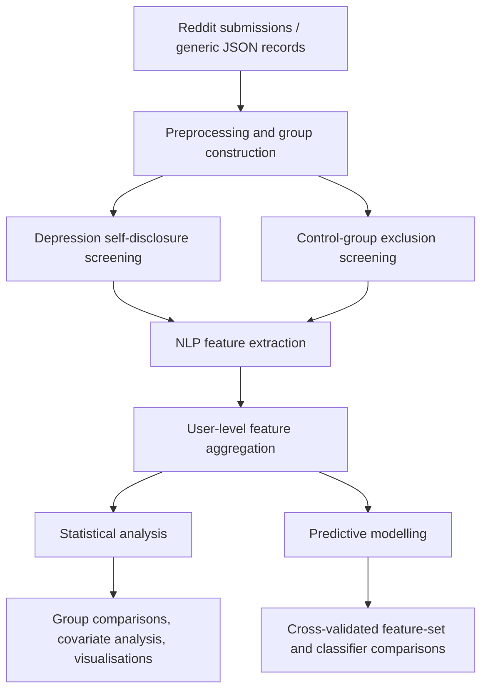

# Discourse- and Structure-Level Linguistic Features for Depression Detection in Social Media Text

**BSc Artificial Intelligence — Final-Year Research Project, King's College London (2025–2026)**  
**Author:** Jingwen Guo · **Supervisor:** Dr Héctor Menéndez

## Overview

Can *how people organise their writing* provide information about depression beyond *what they write about*?

This project develops a modular Natural Language Processing (NLP) framework for investigating depression-related linguistic patterns in social media text. Motivated by clinical research on disorganised speech, it examines whether topic-independent measures—such as semantic coherence, repetition, referential clarity, and word-graph connectivity—remain informative when transferred from elicited clinical speech to spontaneous Reddit writing.

The project combines **corpus construction, interpretable feature extraction, statistical analysis, and supervised classification**. Its focus is on evaluating linguistic markers and their transfer across settings, **not on making clinical diagnoses**.

### Research questions

1. Do discourse- and structure-level features provide useful depression-related signals beyond lexical features in social media writing?
2. To what extent do these feature patterns resemble those reported in previous clinical studies of transcribed speech?

## Framework



The implementation separates the **generic JSON-based pipeline** from **Reddit-specific ingestion and filtering**. The Reddit evaluation streams compressed submission archives, maps platform-specific fields into a common schema, applies group-selection rules, and aggregates extracted features at the user level.

### Linguistic features

| Feature family | Examples | What it captures |
| --- | --- | --- |
| Basic / syntactic | Word count, sentence count, mean sentence length | Text length and sentence structure |
| Discourse and semantic coherence | Semantic coherence, maximum similarity, ambiguous pronoun usage | Continuity of meaning, repetition, clarity of reference |
| Lexical | Article frequencies; first-, second-, and third-person pronouns | Word-use patterns and self-reference |
| Local coherence | Noun overlap, pronoun overlap, content overlap | Continuity between adjacent sentences |
| Speech graph | LCC, LSC, LCCr, LSCr, number of edges, average degree, degree standard deviation | Connectivity of word-transition graphs |

Some lexical features are normalised per 100 words to make comparisons across text lengths more interpretable.

## Experimental evaluation

The evaluation used **2025 Reddit submissions** obtained through public archive links documented by the [Arctic Shift project](https://github.com/ArthurHeitmann/arctic_shift). Group labels are research proxies derived from explicit self-reported diagnosis statements and conservative control-group screening; they are **not clinically verified diagnoses**.

- **2,167 users:** 575 in the self-disclosed depression group and 1,592 in the control group.
- **Unit of analysis:** one aggregated linguistic feature vector per user.
- **Predictive models:** Logistic Regression, Linear SVM, Random Forest, and XGBoost.
- **Validation:** stratified 5-fold cross-validation.
- **Comparison:** lexical, discourse-coherence, syntactic, speech-graph, and combined feature sets.
- **Primary metric:** F1-score, complemented by precision, recall, and ROC-AUC.

### Main predictive results

The following values are from the **final project report (Table 6.2)**. For each feature set, the model shown is the one selected by mean cross-validated F1-score.

| Feature set | Best model | F1 | ROC-AUC |
| --- | --- | ---: | ---: |
| Lexical | Logistic Regression | 0.692 | 0.900 |
| Discourse-coherence | Logistic Regression | 0.647 | 0.852 |
| Syntactic | Logistic Regression | 0.278 | 0.519 |
| Speech-graph | Linear SVM | 0.553 | 0.764 |
| **All features** | **Logistic Regression** | **0.711** | **0.913** |

The highest ROC-AUC observed for the combined feature set was **0.914** with Random Forest, while Logistic Regression achieved the highest F1-score (**0.711**).

**Key finding:** Lexical features were the strongest individual feature family. Combining feature families yielded the best overall F1-score, suggesting that discourse and structural information can complement lexical markers, although the improvement should not be interpreted as proof of clinical validity or statistically significant incremental benefit.

The statistical analysis also found that lexical-rate and local-coherence patterns were more prominent than classic speech-graph differences. This contrasts with some findings from controlled clinical speech studies and highlights the importance of **text modality and context** when interpreting linguistic biomarkers.

### Example analysis outputs


[View the feature-relationship heatmap](Evaluation%20with%20Reddit%20data/reddit%20statistical%20analysis/feature_relationship_results/heatmap_t_statistics.png) · [View additional result figures](Evaluation%20with%20Reddit%20data/reddit%20statistical%20analysis/feature_visual_analysis)

## Repository structure

```text
.
├── filtering modules/             # Generic JSON-based group filtering
├── feature extraction/            # Reusable linguistic feature extraction pipeline
├── feature analysis/              # Statistical analysis, visualisation and tests
├── predictive modelling/          # Classifier comparison and cross-validation
├── Evaluation with Reddit data/   # Reddit-specific filtering, analysis and notebooks
└── .gitignore
```

Each major module has its own source files; several include module-specific `README` instructions, requirements, and `pytest` tests. The repository contains both reusable components and the Reddit-specific experimental adaptation.

## Getting started

**Requirements:** Python 3.10+, Git, and an environment able to install the NLP libraries and model resources. The project was developed primarily using Python scripts, PowerShell helpers, and Jupyter notebooks.

### 1. Clone and create an environment

```powershell
git clone https://github.com/JingwenLindaGuo/bachelor-thesis.git
cd bachelor-thesis
python -m venv .venv
.\.venv\Scripts\Activate.ps1
```

### 2. Install the feature-extraction dependencies

```powershell
pip install -r "feature extraction/requirements_feature_extraction_pipeline.txt"
python -c "import benepar; benepar.download('benepar_en3')"
python -c "import nltk; nltk.download('punkt'); nltk.download('stopwords'); nltk.download('averaged_perceptron_tagger')"
```

The requirements file references the upstream `speechgraph` package. Depending on the local environment, additional NLP model downloads or compatibility adjustments may be required.

### 3. Run the generic feature-extraction pipeline

Prepare an input JSON file containing a record or a list of records with a `text` field. Then, from the repository root:

```powershell
python "feature extraction/feature_extraction_pipeline.py" --input "path/to/input.json" --output "path/to/output_with_features.json"
```

The output preserves the input metadata and adds a `features` object for successfully processed records. A record is skipped if a required feature extractor fails; sufficiently long, multi-sentence input is recommended for discourse and graph analysis.

For group filtering, consult [`filtering modules/README_processfiles.md`](filtering%20modules/README_processfiles.md). For the Reddit-specific ingestion and diagnosis-screening workflow, consult [`Evaluation with Reddit data/reddit filtering modules/README.md`](Evaluation%20with%20Reddit%20data/reddit%20filtering%20modules/README.md). **LLM-based diagnosis-disclosure verification requires an API key when enabled; generic feature extraction does not.**

### 4. Explore the analyses and tests

- Statistical analysis: [`feature analysis/feature_analyse.ipynb`](feature%20analysis/feature_analyse.ipynb)
- Predictive modelling: [`predictive modelling/predictive_modelling.ipynb`](predictive%20modelling/predictive_modelling.ipynb)
- Reddit evaluation: [`Evaluation with Reddit data/`](Evaluation%20with%20Reddit%20data)
- Unit tests: the `tests/`, `test/`, and `test/pytests/` directories within the modules.

The notebooks and predictive-modelling scripts require appropriately prepared feature JSON inputs. They are **not** a one-command reproduction of the complete Reddit archive experiment.

## Reproducibility, data and limitations

- **Data availability:** Raw Reddit archives and user-level source texts are not distributed in this repository. Reproducing the full study requires independently obtaining appropriate input data and following the documented filtering and aggregation procedures.
- **Result provenance:** The performance table above is taken from the final report. Some checked-in CSV outputs (including the `dummy_model` cross-validation examples) are test fixtures, **not** the reported full-study benchmark.
- **Research limitations:** Self-reported labels, potential topic/subreddit confounding, class imbalance, temporal coverage limited to 2025, and cross-platform domain shift constrain interpretation. The observed associations must not be treated as clinical diagnostic markers.
- **Ethics:** Social media text can contain sensitive mental-health information. Review privacy, consent, data-use conditions, and applicable laws before collecting, publishing, or reusing user-level data.

## Acknowledgements and attribution

This work was completed as a final-year BSc Artificial Intelligence project at **King's College London**, supervised by **Dr Héctor Menéndez**. It was informed by earlier clinical NLP research, including the work of **Sarah E. Morgan and colleagues** on discourse-level markers in transcribed speech.

The Reddit data source and portions of the compressed-archive streaming approach are associated with [Arthur Heitmann's Arctic Shift project](https://github.com/ArthurHeitmann/arctic_shift). `speechgraph` is an external dependency. Please consult the respective upstream repositories and licence terms before redistributing or adapting third-party code.
